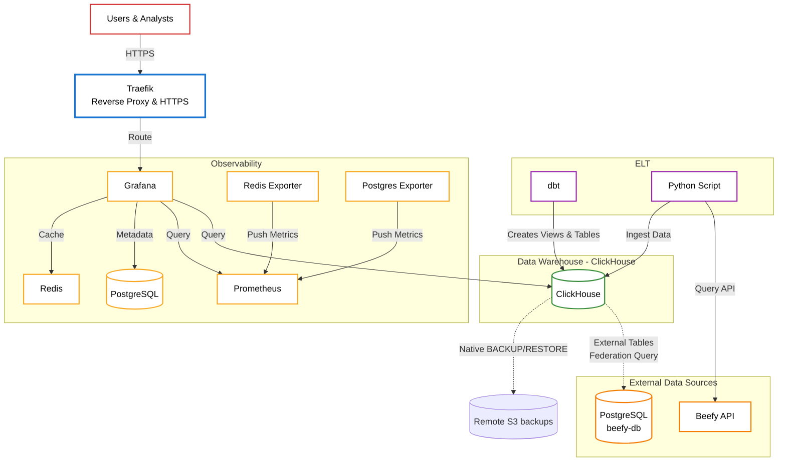
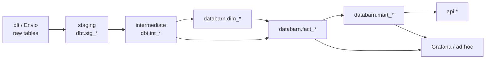

# Beefy Databarn

Full stack data platform for federating multiple external data sources with ClickHouse, dbt, monitoring, and API capabilities.

## Overview

Beefy Databarn is a modern data platform designed to aggregate, transform, and analyze data from multiple external sources (primarily PostgreSQL databases) without requiring data replication. The platform leverages ClickHouse's federation capabilities to query external databases directly, while using dbt for data modeling and transformation. This architecture enables real-time analytics, business intelligence, and monitoring without the overhead of maintaining duplicate data copies.

### Key Concepts

**Data Federation**: Instead of copying data from source databases, ClickHouse uses external table engines (PostgreSQL engine) to query remote databases on-demand. This means:
- No data duplication or storage overhead
- Always up-to-date data (queries hit the source directly)
- Reduced ETL complexity and maintenance

**dbt Data Modeling**: The platform follows a three-layer data modeling approach:
1. **Staging**: External tables that point to source databases (read-only views)
2. **Intermediate**: Data cleaning, standardization, and business logic transformations
3. **Marts**: Business-ready analytical models for consumption (revenue, yield, dimensions)

**Production-Ready Infrastructure**: The platform includes monitoring, security, and orchestration tools for reliable production deployment.

## Architecture



### Component Descriptions

- **ClickHouse**: Columnar analytics database that uses PostgreSQL table engines to federate queries to external databases. Stores transformed data in marts for fast analytical queries.

- **dbt**: Data transformation tool that manages the data modeling pipeline:
  - Creates external tables in ClickHouse pointing to source databases (staging layer)
  - Transforms and cleans data (intermediate layer)
  - Builds business-ready analytical models (marts layer)
  - Runs on a schedule via cron jobs in production

- **Traefik**: Reverse proxy that handles:
  - HTTPS termination with Let's Encrypt certificates
  - Routing to internal services
  - Blue-green deployment support

- **Prometheus + Grafana**: Monitoring stack that collects metrics from all services and provides dashboards for infrastructure health, query performance, and system resources.

- **Backups**: the prod `clickhouse-backup` sidecar runs native ClickHouse `BACKUP` to a local staging disk (`${STORAGE_DIR}/clickhouse-backups`, needs room for one full), then uploads it to a remote S3 server (`CLICKHOUSE_BACKUP_S3_*` in `.env`) with `mc mirror`, which retries and resumes: daily full, hourly incrementals. dlt staging stays on local `file://`.

- **Docker Swarm**: Container orchestration for production deployment, enabling high availability and service management across multiple nodes.

## Quick Start

### Prerequisites

- Docker and Docker Compose (for local development)
- Docker Swarm (for production deployment)
- uv (Python package manager)
- Access to external PostgreSQL "beefy-db" database

### Local Development Setup

**Quick start (automated):**
```bash
make setup          # Setup .env and install dependencies
make infra start    # Start infrastructure services (ClickHouse auto-initializes)
make dbt run        # Run dbt models
```

**Manual setup:**

1. Clone the repository and run initial setup:
   ```bash
   make setup
   # Or manually:
   cp .env.example .env  # Edit .env with your credentials
   uv sync               # Install dependencies
   ```

2. Start infrastructure services:
   ```bash
   make infra start      # Start ClickHouse, Grafana, Prometheus
   # ClickHouse automatically initializes on first startup
   ```

3. Run dbt models:
   ```bash
   make dbt run          # Run all models
   make dbt test         # Run tests
   ```

4. Access services:
   - ClickHouse: http://localhost:28123
   - Grafana: http://localhost:13000 (admin/changeme by default)
   - Prometheus: http://localhost:19090

**Other useful commands:**
```bash
make help             # Show all available commands
make infra logs       # View infrastructure logs
make infra ps         # Check service status
make [clickhouse|ch] backup status   # Prod backups in the remote S3 bucket (dev never pushes backups)
make [clickhouse|ch] backup list
make [clickhouse|ch] dev-usage        # dev_* database sizes vs 20 GiB quota (DEV_DB_QUOTA_GB to change; exits 1 if over)
make [clickhouse|ch] backup pull [BACKUP=inc-YYYY-MM-DD-HH] [YES=1]  # Restore prod data dbs locally (default: newest full)
# Retention: 2 fulls (~100GB each) + today's hourly incrementals; override with CLICKHOUSE_BACKUP_KEEP_FULLS
```

### Production Deployment (Docker Swarm)

1. Follow steps 1-2 from Local Development Setup
2. Navigate to production directory:
   ```bash
   cd infra/prod
   ```

3. Build and deploy infrastructure:
   ```bash
   # Build images (dbt, etc.)
   make build

   # Deploy stack
   make deploy
   # Or combine: make deploy (builds and deploys)
   ```

4. ClickHouse automatically initializes on first startup via init script

5. Run dbt models (dbt runs on a schedule via cron in production):
   ```bash
   # Or manually trigger from dbt container:
   docker exec -it <dbt-container> /app/run_dbt.sh
   ```

**Production Management:**
```bash
cd infra/prod
make ps              # Show running services
make logs            # View logs from all services
make up              # Rolling update (redeploy stack)
```

## Project Structure

- `infra/`: Infrastructure configurations (dev/prod stacks, ClickHouse, Traefik, monitoring)
  - `infra/prod/`: Production deployment files (Makefile, docker-stack.yml, docker-compose.build.yml)
  - `infra/dev/`: Development docker-compose configuration
  - `infra/dbt/`: dbt container configuration (Dockerfile, cron jobs)
- `dbt/`: dbt project (layers and naming in `dbt/CONVENTIONS.md`)
- `dlt/`: Future data ingestion pipelines
- `hasura/`: Future GraphQL API setup

## dbt Models

Layers, naming and grain follow [dbt/CONVENTIONS.md](dbt/CONVENTIONS.md). In short: one folder and one model prefix per
layer; the user-facing tables (`dim_*`, `fact_*`, `mart_*`) all sit in the `databarn` database under their model name,
the API views in `api`; every fact and mart name ends with its grain.

| layer | folder | model | ClickHouse | what |
|---|---|---|---|---|
| staging | `staging/<source>/` | `stg_<source>__<table>` | `dbt.stg_*` | 1:1 cleanup of a source table |
| intermediate | `intermediate/<domain>/` | `int_*` | `dbt.int_*` | building blocks |
| data quality | `data_quality/` | `dq_*` | `dbt.dq_*` | lists of known gaps to inspect |
| dimension | `dimensions/` | `dim_<entity>` | `databarn.dim_<entity>` | one row per entity |
| fact | `facts/<domain>/` | `fact_<subject>_<grain>` | `databarn.fact_<subject>_<grain>` | reusable: one row per observation (`_obs`) or per entity per period (`_5m`, `_1h`, `_1d`), and `_latest` views |
| mart | `marts/<consumer>/` | `mart_<subject>_<grain>` | `databarn.mart_<subject>_<grain>` | shaped for one dashboard or question |
| api | `api/` | `api_<endpoint>` | `api.<endpoint>` | REST API contracts |
| legacy | `legacy/` | `legacy_<old name>` | `analytics.<old name>` | temporary: the old `analytics` names over the new tables, until 2026-12-31 |

The table name is the model name (`fact_product_stats_1h` is `databarn.fact_product_stats_1h`), except in `api` and
`analytics`, which drop the prefix. `macros/generate_alias_name.sql` does this, and fails the build when a model lacks
its prefix or, for facts and marts, its grain.

### Data Flow



### Example: Harvest Events Flow

1. **Source**: the beefy-db `harvests` table, loaded by dlt into `dlt.beefy_db___harvests`
2. **Staging**: `stg_beefy_db__harvests` types and deduplicates it
3. **Intermediate**: `int_harvests` cleans it and prices each harvest from `fact_asset_price_5m`
4. **Fact**: `fact_harvest_obs` (`databarn.fact_harvest_obs`) joins the product dimension and computes USD values
5. **Mart**: `mart_revenue_summary_1d` sums it per day with buybacks and fee batches; `api_revenue_summary` serves it

### Prices

One price per asset and 5-minute slot, resolved once and reused by every model that needs a price.

| model | what |
|---|---|
| `int_price_obs` | Every raw price observation, keyed by source series: beefy_db oracle prices, Beefy API share prices, databarn v1 ppfs and price feeds, CLM subgraph share prices (`macros/prices/price_sources.sql`). Each run re-reads the last 3 days of each source and inserts the rows it does not have yet. |
| `int_price_series_map` | Which series prices which asset, with every special case as a column: priority, validity windows (aliases such as oldBIFI and WROSE), unit fixes, the want of a vault share. Listed from the dimensions, so a new product or oracle is mapped with its whole history. |
| `int_price_oracle_corrections`, `int_mootoken_price_corrections` | Hand-made correction windows, priority 90. |
| `int_price_asset_creation` | Creation time of each vault and CLM share asset (envio, else databarn v1, else the API's declared date), for the backfill. |
| `fact_asset_price_5m` | Dense 5-minute price of every asset (materialization `price_resolver`): in each slot the observation of highest priority, newest first; otherwise the last value carried for up to a day (a vault share keeps its ppfs and follows its want price). Each run resolves the new slots and recomputes, from the first changed slot, every asset whose observations, map rows or corrections changed. It logs what it changed in `int_price_runs`. `observed_at` is the slot of the value a row holds or carries, so a row's age is `date_time - observed_at`. Backfill: first deposits come minutes after deployment, before any source prices the share, so an asset's first value is carried back to the creation of its vault or CLM when it comes at most `price_backfill_days` (5) later. A vault carries its first ppfs times the want price of each slot. These rows have `is_carried = 1` and `observed_at > date_time`; `int_price_backfills` keeps what each asset got. |
| `fact_asset_price_1d`, `fact_asset_price_latest` | Daily OHLC; last price of each asset. |

**Priced models.** A model that stores a price or a USD value looks it up in `databarn.fact_asset_price_5m` on its row's 5-minute
slot, with a key lookup (`WHERE (asset_id, date_time) IN (SELECT asset_id, slot FROM facts)`), never an ASOF join
(ClickHouse loads the whole right side of an ASOF join into memory). Small marts are priced in full each run
(`fact_buyback_obs`, `fact_zap_obs`, `fact_harvest_obs`). Incremental ones also recompute the rows of the assets a
resolver run changed (`macros/prices/price_runs.sql`): `int_harvests`, `int_databarn_v1__vault_stats_1h`, the
`int_product_stats__*_1h` models, `fact_product_stats_1h`, `fact_account_balance_change_obs`, `fact_account_balance_1d`.

**Latency.** beefy_db writes prices every 15 minutes and dlt loads them within minutes; dbt runs every 30 minutes and
resolves up to 10 minutes before the run. A new price reaches the marts 15 to 45 minutes after it is observed.

**Operations.**
- Late raw data older than 3 days (a dlt reimport): `make reimport-prices <since>` reimports dlt, then
  `make dbt reimport 'int_price_obs+' <since>`.
- A price correction or a series map edit: the next dbt run recomputes the affected assets and their priced rows.
- After a re-resolve of `fact_asset_price_5m` (`--full-refresh`, or `incremental_since` more than 31 days back), the priced
  incremental models fail and name the batched reimport to run: `make dbt reimport '<model>+' <since>`.
- A table of an older schema (`fact_asset_price_5m` without `observed_at`) is rebuilt in full by the next run, which then
  counts as a re-resolve.
- The first run with the backfill (empty `int_price_backfills`) writes the backfilled rows without reporting them to the
  priced models, which would otherwise reprice the whole history of about 2,000 assets in one run. Their rows before
  each product's first price stay unpriced until a batched reimport (`make dbt reimport '<model>+' <since>`).

## Development

### Available Commands

View all commands:
```bash
make help
```

### Infrastructure Management
```bash
make infra start    # Start infrastructure services
make infra stop     # Stop infrastructure services
make infra restart  # Restart infrastructure services
make infra build    # Rebuild infrastructure images
make infra logs     # View logs
make infra ps       # Check service status
```

### dbt Commands
```bash
make dbt run        # Run all models
make dbt test       # Run tests
make dbt compile    # Compile models
make dbt docs       # Generate and serve documentation
```

### Full Workflows
```bash
make dev            # Complete setup: install deps, start services, run dbt
make infra start    # Start infrastructure services
```

### Direct Commands (without make)

If you prefer to use docker-compose and dbt directly:
```bash
# Infrastructure (from project root)
docker-compose -f infra/dev/docker-compose.yml up -d
docker-compose -f infra/dev/docker-compose.yml logs -f
docker-compose -f infra/dev/docker-compose.yml down

# dbt
cd dbt && uv run dbt run
cd dbt && uv run dbt test
```

## Deployment

The platform supports both development and production environments:

- Development: `infra/dev/docker-stack.yml`
- Production: `infra/prod/docker-stack.yml`

Services can be moved between nodes using Docker Swarm labels.

## Monitoring

- Grafana: http://localhost:13000
- Prometheus: http://localhost:19090
- ClickHouse: http://localhost:28123

## Security

- Traefik HTTPS termination with Let's Encrypt
- Docker Swarm network isolation
- Service-level security configurations in docker-stack.yml

